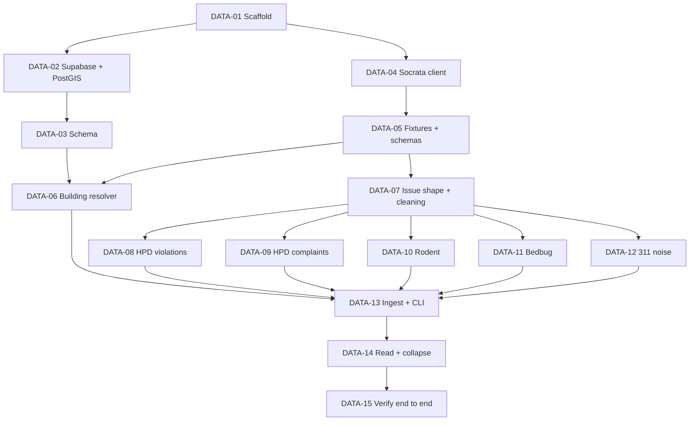

# Hearthstone Hub — Data Pipeline & Database Plan

> Ticketed plan for pulling NYC public records into Supabase. Companion to `spec.md` and `hearthstone-hub-execution-plan.md`.

| | |
|---|---|
| **Status** | Draft v1 |
| **Last updated** | November 1, 2026 |
| **Language** | JavaScript only (Node 22.12+, ES modules, no TypeScript) |
| **Sizing** | S = a day or two · M = a few days (same scale as the execution plan) |
| **Total** | 15 tickets (9 S, 6 M), roughly 5–7 weeks for one developer. DATA-08 to DATA-12 can run in parallel. |

---

## 1. Scope

**In scope:** fetching, validating, cleaning and storing building and issue records, plus the tables that hold them.

**Out of scope:** grading and `grade_baselines`, `report_snapshots`, user tables, API routes, Next.js, UI, maps, cron and Gemini.

**"Scraping" means API calls.** As spec §4 says, every source is a JSON API, so there is no HTML parsing and no headless browser.

**Records are fetched per building, on demand (spec §5.2).** There is no citywide bulk load: the violations dataset alone has about 11 million rows. A CLI drives ingestion until the API routes exist.

---

## 2. Confirmed sources

Checked against the live APIs on November 1, 2026, without an app token.

| Source | Dataset ID | Record ID | BBL field | Date field |
|---|---|---|---|---|
| HPD violations | `wvxf-dwi5` | `violationid` | `bbl` | `inspectiondate` |
| HPD complaints and problems | `ygpa-z7cr` | `problem_id` | `bbl` | `received_date` |
| Rodent inspections | `p937-wjvj` | None confirmed, see DATA-10 | `bbl`, often missing | `inspection_date` |
| Bedbug reporting | `wz6d-d3jb` | None, see DATA-11 | `bbl` | `filing_date` |
| 311 service requests (2020 to present) | `erm2-nwe9` | `unique_key` | `bbl` | `created_date` |
| PLUTO | `64uk-42ks` | n/a | `bbl`, in a different format | n/a |
| GeoSearch | `geosearch.planninglabs.nyc/v2/autocomplete` | n/a | `properties.addendum.pad.bbl` | n/a |

### What the data showed, and how the plan handles it

| Finding | Evidence | Handling |
|---|---|---|
| PLUTO's BBL format differs from every other source | `"4087860042.00000000"` | Normalize it, or joins silently return nothing (DATA-06) |
| Some BBLs are junk | `"0"` and `"0000000000"` both appear | Validate as `^[1-5]\d{9}$`; anything else becomes null (DATA-07) |
| HPD class I isn't in the spec | 806,185 rows outside A/B/C | Dropped by default (DATA-08) |
| Pest and heat violations have no category field | Only the free-text `novdescription` identifies them | Word-boundary text matching; a plain `ROACH` match also hits "APPROACH" (DATA-08) |
| Heat complaints appear in both HPD and 311 | Past 12 months: 356,808 in HPD, 352,817 in 311 (agency HPD) | Take heat from HPD only, or each event counts twice (DATA-12) |
| HPD complaints include flagged duplicates | About 18% have `problem_duplicate_flag = Y` | Drop them (DATA-09) |
| `unique_key` is not unique in HPD complaints | 151,757 `problem_id` values, 136,886 `unique_key` values | Use `problem_id` (DATA-09) |
| Many rodent rows aren't inspections | Bait applied, Cleanup done, Monitoring visit, Stoppage done | Drop them (DATA-10) |
| Rodent rows can lack a BBL | 103,752 null, of which 102,985 have a block and lot | Query by borough, block and lot instead (DATA-10) |
| Most bedbug filings report no infestation | 689,282 of 724,411 report zero | No issue row, but record the filing date (DATA-11) |
| Bedbug rows have no unique ID | `building_id` + `filing_date` gives 710,873 distinct values across 724,411 rows | Composite ID, checked in DATA-11 |
| Timestamps have no time zone | `"2026-10-31T02:53:39.000"` | Store NYC wall-clock time, which is what the "same night" rule needs (DATA-03) |
| 311 radius queries can be slow | One noise query at 150 m took 9.4 s without a token | Measure with a token (DATA-15) |

Timings are single runs, so treat them as indicative only.

---

## 3. Decisions

These fill gaps in the spec or change it. Each is easy to reverse before DATA-03 merges.

| # | Decision | Why |
|---|---|---|
| 1 | **JavaScript everywhere:** `lib/sources.js`, `lib/cleaning-rules.js`, JSDoc in place of the TS `Issue` type. Zod and Vitest stay. | Project requirement. Spec §4, §5.2, §5.3, §10 and §12 still say TypeScript and need updating. |
| 2 | **Don't store `distance_m`.** Compute it when reading. | One 311 row can be near many buildings, so distance belongs to the pair, not the row. |
| 3 | **No foreign key from `issues.bbl` to `buildings`.** | 311 rows carry the BBL of neighbors nobody has searched for. |
| 4 | **311 rows keep their own BBL from the dataset**, not null as in spec §5.2. | The rows are shared between buildings, so the searched building's BBL can't go on them. |
| 5 | **Store rows uncollapsed; collapse repeats when reading.** | Rules can be tuned without refetching, and snapshots can still diff real source IDs later. |
| 6 | **Keep the source row in `issues.raw`.** | Grading needs fields like infested unit counts, and rules can be re-run without refetching. |
| 7 | **Add a `source_fetches` table.** | Spec has no way to track 24-hour freshness per source, or to report what's missing after a partial failure. |
| 8 | **311 supplies noise only.** | The `Issue` categories have no slot for other nearby problems, and heat comes from HPD. |
| 9 | **Noise radius stays at 150 m**, set in one constant. | Spec default; open question 1 in §16. |
| 10 | **One hosted Supabase project on a personal account, and no local Docker database.** Database tests run against it and are skipped when `SUPABASE_URL` isn't set, including in CI. | The development machine doesn't have the disk space for local Supabase. The group hasn't decided whether to share a project; the schema is in migrations and the data can be refetched, so moving later is cheap. Use a separate project for production. |

### Category and severity mapping

Severity outside HPD violation classes isn't defined in the spec, so those values are starting points for grading to tune.

| Source | Rule | Category | Severity | Status |
|---|---|---|---|---|
| HPD violation | Class A / B / C | Pest text → `pests`; heat text → `heat`; otherwise `repairs` | 1 / 2 / 3 | `violationstatus` |
| HPD complaint | `HEAT/HOT WATER` → `heat`; `UNSANITARY CONDITION` + `PESTS` → `pests`; otherwise `repairs` | As in rule | 1 | `problem_status` |
| Rodent | `Failed for Rat Activity`, with or without `and Other Reason` | `pests` | 3 | Open until a later `Passed` |
| Rodent | `Failed for Other Reason` | `pests` | 1 | Open until a later `Passed` |
| Bedbug | Infested units > 0 | `bedbugs` | 1 all eradicated · 2 some remain · 3 re-infested | Open if infested > eradicated |
| 311 | `Noise*`, excluding `Noise - Helicopter` and config list | `noise` | 1 | `status` |

---

## 4. Layout

```
package.json                  "type": "module"
.env.example
.github/workflows/test.yml
lib/
  sources.js                  dataset IDs, windows, radius
  socrata.js                  paginated SODA client
  geosearch.js
  bbl.js                      normalize and validate
  building.js                 resolve address, PLUTO lookup, upsert
  schemas.js                  Zod schemas, Issue JSDoc typedef
  cleaning-rules.js           drop rules
  collapse.js                 repeat collapsing
  fetchers/                   hpd-violations, hpd-complaints, rodent, bedbug, 311
  ingest.js                   runs fetchers, writes to the database
  issues.js                   getBuildingIssues()
scripts/
  ingest.js                   CLI: node scripts/ingest.js "161 Newel St"
  capture-fixtures.js
supabase/migrations/
tests/  tests/fixtures/
```

`lib/` sits at the repo root so the Next.js app can import it directly later.

---

## 5. Order



---

## 6. Tickets

### Foundation

#### DATA-01 — Scaffold the JavaScript project · S
**Depends on:** nothing

- Add `package.json` with ES modules and Node 22.12+ (the latest Supabase client and Vitest need it). The only dependencies are `zod`, `@supabase/supabase-js` and dev `vitest`. Use built-in `fetch` and `node --env-file`.
- Add `.env.example` with `SUPABASE_URL`, `SUPABASE_PUBLISHABLE_KEY`, `SUPABASE_SECRET_KEY` and `SOCRATA_APP_TOKEN` (Supabase is deprecating the `anon` and `service_role` keys by the end of 2026), and put `.env` in `.gitignore`.
- Add a GitHub Action that runs Vitest on every PR.

**Done when:** `npm test` passes locally and in CI, and the repo contains no `.ts` files.

#### DATA-02 — Create Supabase project and enable PostGIS · S
**Depends on:** DATA-01

- Create the Supabase project and register the Socrata app token. Both need a person with the accounts.
- Run `supabase init` and `supabase link`, then add a first migration: `create extension if not exists postgis with schema extensions`. Apply it with `supabase db push`.

**Done when:** `select extensions.postgis_version()` returns a version on the hosted project, and the secrets exist only in `.env` and project settings.

#### DATA-03 — Create the schema · M
**Depends on:** DATA-02

```sql
create table buildings (
  bbl text primary key check (bbl ~ '^[1-5][0-9]{9}$'),
  bin text,
  address text not null,
  borough text not null,
  geom extensions.geography(Point, 4326) not null,
  units_res int,                -- null when PLUTO has no match
  year_built int,
  updated_at timestamptz not null default now()
);

create table issues (
  source text not null check (source in ('hpd_violation','hpd_complaint','rodent','bedbug','311')),
  source_id text not null,
  bbl text check (bbl ~ '^[1-5][0-9]{9}$'),  -- no FK: 311 rows may reference unsearched buildings
  category text not null check (category in ('repairs','heat','pests','bedbugs','noise')),
  severity smallint not null check (severity between 1 and 3),
  status text not null check (status in ('open','closed')),
  observed_at timestamp,        -- NYC wall-clock time; the sources have no time zone
  description text not null,
  geom extensions.geography(Point, 4326),
  raw jsonb not null,
  fetched_at timestamptz not null default now(),
  primary key (source, source_id)
);
create index on issues using gist (geom);
create index on issues (bbl, source);

create table source_fetches (
  bbl text not null references buildings on delete cascade,
  source text not null,
  last_attempt_at timestamptz not null,
  last_success_at timestamptz,  -- freshness is checked against this
  last_error text,
  row_count int,
  latest_record_at timestamp,   -- e.g. last bedbug filing, even if it reported zero
  primary key (bbl, source)
);
```

- Add RPC `issues_near(lat, lon, radius_m, since)`, returning issue rows plus a computed `distance_m` using `ST_DWithin`. The Supabase client can't express this query directly. Set the function's `search_path` to `public, extensions` so it can find PostGIS.
- Enable RLS on all three tables. `buildings` and `issues` are public-read, and only the service role writes. `source_fetches` has no public policy.

**Done when:** migrations apply with `supabase db push`; tests against the hosted project show the publishable key can read issues but not write them, can't read `source_fetches`, and `issues_near` returns only rows inside the radius, nearest first. Tests use reserved fake BBLs and `source_id` values, and remove only those rows afterward.

### Source access

#### DATA-04 — Pin sources and build the Socrata client · S
**Depends on:** DATA-01

- Put the IDs from section 2, the time windows from spec §5.2 and the radius in `lib/sources.js`.
- `querySocrata(datasetId, { select, where, order })` sends the app token, encodes parameters and follows pages.
- **Pagination is the critical part:** SODA returns only 1,000 rows by default, with no error. Page with `$limit`, `$offset` and a stable `$order` until a short page returns.
- Retry 429 and 5xx up to 3 times with backoff; don't retry other 4xx. Set a request timeout. Errors name the source and query, and never include the token.

**Done when:** mocked-`fetch` tests cover a multi-page result, retry then success, retry exhaustion, and a 400 with no retry. A failure partway through paging throws and never returns partial rows.

#### DATA-05 — Capture fixtures and write Zod schemas · M
**Depends on:** DATA-04

- Choose test addresses across boroughs: many violations, clean, 100+ units, 1–5 units, near nightlife, **a condo** (`75xx` lot) and **a lot with several buildings**.
- `scripts/capture-fixtures.js` saves real responses from every source to `tests/fixtures/`.
- Write one Zod schema per response in `lib/schemas.js`, requiring only the fields the code uses so new upstream columns don't break anything.
- Re-run the citywide `group by bbl` counts with a token and record timings for the grading work. Without a token, violations took 21 s, 311 noise took 110 s, and a grouped rodent query timed out at 120 s.

**Done when:** every schema passes against every fixture; written-up answers exist for how condos and multi-building lots appear in each source.

#### DATA-06 — Resolve an address to a building · S
**Depends on:** DATA-03, DATA-05

- `lib/bbl.js`: `normalizeBbl()` converts `"4087860042.00000000"` to `"4087860042"` and returns null for invalid values.
- `lib/geosearch.js`: return the top 5 matches with label, BBL, BIN and coordinates, for later use by `/api/geocode`.
- `lib/building.js`: look up `unitsres` and `yearbuilt` in PLUTO, then upsert into `buildings`.
- A missing PLUTO row, or `unitsres = 0`, must not fail the upsert. Store what PLUTO gives and leave grading to handle it.

**Done when:** tests cover BBL normalization, a PLUTO miss and a repeat upsert. `161 Newel St` resolves to BBL `3026230011`, BIN `3065755`.

### Fetchers

Each fetcher exports `fetch(building)` and returns `{ issues, latestRecordAt }`. It validates the response, maps it to the `Issue` shape, applies drop rules and has fixture-based tests.

#### DATA-07 — Define the Issue shape and shared cleaning rules · S
**Depends on:** DATA-05

- Add a JSDoc `Issue` typedef and Zod schema (spec §5.2 without `distanceM`), and export the shape to frontend developers per execution plan §5.
- `lib/cleaning-rules.js` holds the 311 exclusions and "drop if no date and no location" as tunable data.
- A shared helper validates `bbl` and builds the EWKT string `SRID=4326;POINT(lon lat)`, with longitude first, for `geom`.

**Done when:** tests cover each drop rule, including that a row missing only one of date and location is kept.

#### DATA-08 — HPD violations fetcher · M
**Depends on:** DATA-07

- Query: `bbl = X AND (inspectiondate >= 3 years ago OR violationstatus = 'Open')`.
- Apply the mapping in section 3. Pest and heat matching uses word-boundary patterns held in config.
- Confirm what class I means on the dataset page, then either keep the default (drop) or map it.
- Fall back to `novissueddate` when `inspectiondate` is empty.

**Done when:** a test proves "APPROACH" isn't tagged as a pest and "ROACHES" is; an open violation older than 3 years is returned; classes map to severity correctly.

#### DATA-09 — HPD complaints fetcher · S
**Depends on:** DATA-07

- Query: `bbl = X AND received_date >= 12 months ago`, excluding `problem_duplicate_flag = 'Y'`.
- `source_id` is `problem_id`. `description` combines `major_category`, `minor_category` and `problem_code`.

**Done when:** tests cover flagged duplicates being dropped and each category mapping, including that mold goes to `repairs`.

#### DATA-10 — Rodent inspections fetcher · S
**Depends on:** DATA-07

- Query by `boro_code`, `block` and `lot` so rows with no `bbl` are included; check in the fixtures that block and lot formats match the BBL parts.
- Window: last 2 years. Keep `Passed` rows long enough to close earlier failures, then don't emit them as issues.
- Check whether `job_id` is unique. Default `source_id` is `job_id|inspection_date`.
- Report `latest_record_at` from any real inspection, including a pass.

**Done when:** tests cover a row with no BBL being found, bait and stoppage rows being dropped, and a failure followed by a pass becoming closed.

#### DATA-11 — Bedbug filings fetcher · S
**Depends on:** DATA-07

- Query: `bbl = X`, latest 2 filing years.
- Emit issues only where `infested_dwelling_unit_count > 0`. `raw` retains the unit counts for per-unit grading.
- Report `latest_record_at` from any filing, so "reported zero" and "never filed" stay distinguishable.
- Default `source_id` is `building_id|registration_id|filing_date|filling_period_end_date` (the misspelling is upstream). Check citywide that it is unique, and add fields if not.

**Done when:** tests cover a zero filing (no issue, date recorded) and the three severity cases. The uniqueness check is recorded in the ticket.

#### DATA-12 — 311 noise fetcher · M
**Depends on:** DATA-07

- Query: `within_circle(location, lat, lon, 150) AND created_date >= 12 months ago AND complaint_type like 'Noise%'`.
- Exclude helicopter and other configured types, plus duplicate and out-of-jurisdiction closures. Those closures are only described in `resolution_description`, so collect the real wording from fixtures first.
- Do not pull `HEAT/HOT WATER` from 311.
- Keep each row's own validated `bbl`.

**Done when:** tests cover helicopter and closure exclusions, a null `bbl` for unaddressed complaints, and a row whose BBL differs from the searched building's.

### Assembly

#### DATA-13 — Ingest orchestrator and CLI · M
**Depends on:** DATA-06, DATA-08 to DATA-12

`ingest(building)` runs these steps for each source:

1. Skip the source if `last_success_at` is under 24 hours old.
2. Run all fetchers with `Promise.allSettled`, so one failure doesn't stop the others.
3. Upsert issues in batches on `(source, source_id)`.
4. **For BBL-scoped sources only, delete rows for this BBL whose ID wasn't returned.** Otherwise an old open violation that gets closed drops out of the query window and stays "open" here forever.
5. Update `source_fetches`. On failure, record the error and leave existing rows untouched.

Never reconcile deletes for 311 rows, since they're shared with neighboring buildings.

Add `scripts/ingest.js "<address>"`, printing per-source counts and errors, with `--force` to skip the freshness check.

**Done when:** tests against the hosted project, using reserved fake BBLs, show that a second run within 24 hours fetches nothing; a re-run creates no duplicates; a status change updates in place; **a failed source deletes nothing**; one failed source still lets the others save.

#### DATA-14 — Read clean issues and collapse repeats · M
**Depends on:** DATA-13

`getBuildingIssues(bbl)` returns building-scoped rows, plus 311 rows from `issues_near` with `distance_m`, plus a list of sources that failed or are stale.

`lib/collapse.js` is a pure function applied to 311 rows only (HPD records are already unique):

- Same type + same location + same night → 1. A night runs 6 pm to 6 am and belongs to the date it started on.
- Same type + same building + same daytime calendar day → 1.
- Each collapsed row keeps its `source_id` list and count.

**Done when:** tests cover 10 complaints in one night becoming 1; 11 pm and 2 am sharing a night; 2 am and 7 pm the next evening staying separate; a read with a failed source naming that source. No database rows change on read.

#### DATA-15 — Verify end to end · S
**Depends on:** DATA-14

- Run the CLI against every test address on the hosted project with a real token.
- Compare counts for 3 addresses by hand with the city's public HPD and 311 records.
- Record time per source. If a fresh ingest is too slow for a page load (the 9.4 s above suggests it may be), note it for the report-route work.
- Write surprises and decisions back into `spec.md`, including the TypeScript references in decision 1.

**Done when:** every test address ingests cleanly, the high-violation address visibly has more issues than the clean one, timings are recorded, and the spec matches what was built.

---

## 7. Risks

| Risk | Ticket | Mitigation |
|---|---|---|
| Rows silently truncated at 1,000 | DATA-04 | Page until a short page; a partial result throws |
| Reconcile delete wipes good data | DATA-13 | Delete only after a fully paged success, never for 311 |
| Condos and multi-building lots attach issues to the wrong record, since BBL is a lot rather than a building | DATA-05 | Test addresses for both; update spec before DATA-13 if needed |
| Text matching mislabels violations | DATA-08 | Patterns in config, tested on real fixtures, `raw` retained for re-runs |
| Fresh ingest too slow for a live page | DATA-15 | Measure with a token; a slow 311 fetch can load separately |
| Upstream fields or IDs change | DATA-05 | Zod fails loudly, and the IDs live in one file |
| Database tests touch real rows, since there's no local database | DATA-03, DATA-13 | Tests use reserved fake BBLs and clean up only those; any lost real data can be refetched |
| 311 rows accumulate indefinitely | DATA-13 | `issues_near` filters by date so results stay right; add pruning if storage becomes a concern |
