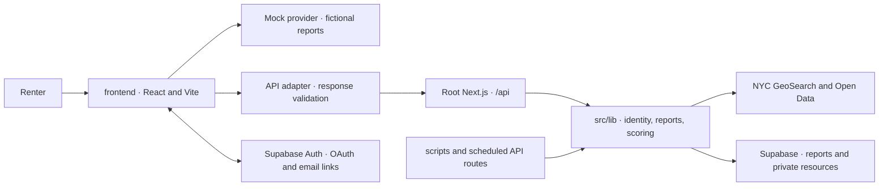

# Hearthstone Hub architecture

## Applications and ownership

The approved renter interface is a standalone React, TypeScript, and Vite package in `frontend/`. It owns navigation, reports, maps, comparison controls, preferences, and browser Supabase authentication. Its service adapters keep the pages independent of API response shapes.

The existing backend runs as part of the root Next.js application. HTTP entry points live in `src/app/api/`, with shared server logic in `src/lib/`, session refresh in `src/proxy.ts`, operational commands in `scripts/`, and database migrations in `supabase/`. The root application also contains an earlier UI that still imports the same report, scoring, and authentication modules.

Each deployable application uses its own npm manifest, lockfile, and environment. The root TypeScript and ESLint configurations exclude `frontend/`. Application checks run from their own directories. npm's existing `--prefix` option is sufficient for invoking frontend commands from the root.

## Directory audit

| Top-level folder | Classification | Decision |
| --- | --- | --- |
| `frontend/` | Frontend application | Approved UI and OAuth implementation |
| `src/` | Backend application and existing Next.js UI | Retain together while shared imports and active branches are reconciled |
| `scripts/` | Backend operations | Retain ingestion, source smoke checks, seeding, and RLS checks |
| `supabase/` | Backend infrastructure | Retain existing migrations and access policies |
| `tests/` | Backend and Next.js verification | Retain existing unit and browser suites |
| `docs/` | Documentation | Current architecture and API, data-source, scoring, and lease references |
| `reference/` | Documentation and supplied design material | Retain original references |
| `public/` | Existing Next.js assets | Empty in this checkout, used as the embedded-build destination upstream |
| `.git/` | Shared version-control metadata | Local repository state |
| `node_modules/`, `.next/`, `test-results/` | Generated local files | Already ignored, absent from tracked source |

The frontend also has ignored dependency, build, and test-output directories. The tracked-file audit found no committed `node_modules`, `dist`, `.next`, or test outputs.

Following the folder audit and the repository owner's cleanup request, the unused `aptsignal-auth/` application and `prototype/` experiment were removed. Neither active application imported them. The frontend retains its centralized Supabase OAuth implementation, and the root application retains its own cookie authentication and integrated Gemini advice. The removed source remains in Git history.

There is no root GitHub Actions workflow on this branch.

## Data flow

Search first requests address candidates and resolves the selected label. The backend reconciles building identity using GeoSearch, HPD registrations, and tax-lot metadata. Source adapters normalize HPD violations, bedbug filings, rodent inspections, and relevant 311 complaints into evidence records.

The report service caches bounded snapshots and can retain earlier source-specific evidence with a stale label during an outage. Supabase supports durability across process restarts. Scoring retains source coverage and distinguishes missing evaluation data from favorable results. The frontend validates the report response and maps it into its own domain models.

The existing ingestion route refreshes an oldest known building, upserts evidence, records score snapshots, and records ingestion metadata. The cleanup route removes expired private leases. `vercel.json` schedules these routes. Existing query limits, tax-lot ambiguity, calibrated-grade requirements, and PDF-processing limitations are described in the [data-source guide](DATA_SOURCES.md), [scoring guide](SCORING.md), and [lease guide](LEASE_SAFETY.md).

## API and authentication boundaries

`frontend/src/services/contracts.ts` defines the housing, scoring, saved-property, and authentication interfaces. `runtime.ts` selects mock or API housing data. `api.ts` uses `VITE_API_BASE_URL` and validates responses against the [existing API contract](API.md). Browser code imports only frontend modules and installed frontend dependencies.

The frontend has one centralized Supabase client in `frontend/src/lib/supabase.ts`. It starts Google or GitHub OAuth and the retained email-link flow. Its `/auth/callback` route completes PKCE once, verifies the returned user, and restores a validated internal destination. The Auth provider listens for initial sessions, sign-in, sign-out, token refresh, and user updates. Protected routes control UI access. The backend independently controls access to private resources.

Mock saves use separate storage keys for anonymous visitors and individual Supabase users. API saves send the current bearer token, omit cookies, and guard against changing users during an operation. The root backend currently verifies cookie sessions through `src/lib/db.ts`. Backend maintainers need to add verified bearer-token support and owner authorization before cloud saves work with browser OAuth.

The root app retains its existing cookie-auth flow. It can share a Supabase project and identities with the frontend. Sharing a project does not automatically share cookies or sessions between the applications. Credentials and secrets remain in each app's ignored local environment or deployment configuration.

The frontend assistant is currently unavailable. The existing root `/api/advisor` stays deterministic. A separate root `/api/ai/advice` route can call Gemini for a live building report when its server key is configured, with a deterministic fallback. Its implementation is documented in [the Gemini integration notes](gemini-integration.md). The previous architecture document's repository-wide AI-disabled statement predates this route.

## Deployment

The Vite package builds to `frontend/dist/` and can be hosted independently with a history fallback for public routes, `/login`, `/signup`, and `/auth/callback`. The local Vite proxy forwards only `/api` to the configured backend. The backend retains its root Next.js build and Vercel cron configuration. Separate API origins require explicit server CORS configuration.

Upstream main has introduced an embedded Vite build into `public/hearthstone/` and Next.js rewrites. Those changes are outside this branch's current runtime. Reconcile that hosting approach with the frontend-owned login and callback routes before integration.

## Coordinated backend migration

The November 19, 2026 audit started on clean `frontEndConcept` at `9a4d74a`. After fetching GitHub, the merge base with `origin/main` was `4a676c1`. This branch had one commit beyond the merge base and main had twelve, including deployment, scoring, and overlapping frontend work. Routing and data-pipeline branches also contain a separately developed ingestion package and route work.

Moving the root application during that work would combine path conflicts with behavior conflicts. This cleanup keeps its runtime location under the brief's collaboration exception. The intended subsequent structure is a sibling `frontend/` and `backend/`, with shared documentation at the root.

1. Reconcile the current main, routing, data-pipeline, and OAuth changes with the responsible contributors and agree which backend entry points will be deployed.
2. Move the existing root application's `src/`, `scripts/`, `supabase/`, `tests/`, applicable assets, manifest, lockfile, and Next.js/test configuration together into `backend/`. Preserve its Next.js framework and the earlier UI until the maintainers decide its lifecycle.
3. Update the backend alias paths, deployment root, scheduled routes, environment loading, and operational script paths together. Reconcile upstream's embedded frontend build separately.
4. Add verified bearer-token handling using the shared Supabase project and owner-scoped authorization. Keep existing cookie callers working during the transition.
5. Run both application suites, builds, backend permission checks in an isolated database, and deployment checks before changing the hosted root.

Package manifests and lockfiles retain their existing ownership until the coordinated migration.

## Contributor checks

From the repository root, use `npm run typecheck`, `npm run lint`, `npm test`, and `npm run build` for the existing Next.js application. Use the frontend equivalents with `npm --prefix frontend`. The frontend browser suite tests mock housing data and mocked Supabase responses independently of the backend.

OAuth provider configuration, live NYC responses, hosted database access policies, and production deployment need separate configured verification. `npm run test:rls` creates temporary users and must target an isolated database. The root README includes installation, environment, and development commands for each application.

## Verification from this cleanup

The existing root dependencies were reinstalled with `npm ci` using the existing lockfile. Frontend dependency verification, both TypeScript checks, root lint, 24 frontend unit tests, 59 backend unit tests, and 14 frontend browser tests passed. Both production builds completed.

The initial cleanup build on Next.js 16.4.3 stopped after compilation with a security notice, then completed on retry with the warning. The subsequent version update pins the root application and its matching ESLint configuration to 16.4.6. Root TypeScript, lint, all 59 backend unit tests, and the production build passed again, and the build no longer emitted that security notice. The frontend build still reports bundle-size warnings. The existing root Vitest configuration emits a future module-loader warning.

The initial root TypeScript check included Vite source and encountered stale local dependency installation. Root lint included the generated frontend bundle. Reinstalling root dependencies and excluding the independent frontend package resolved those checks.

Browser authentication tests use mocked Supabase endpoints. Live OAuth, NYC queries, database migrations, RLS user-creation checks, and hosted deployments were outside the verification run.
