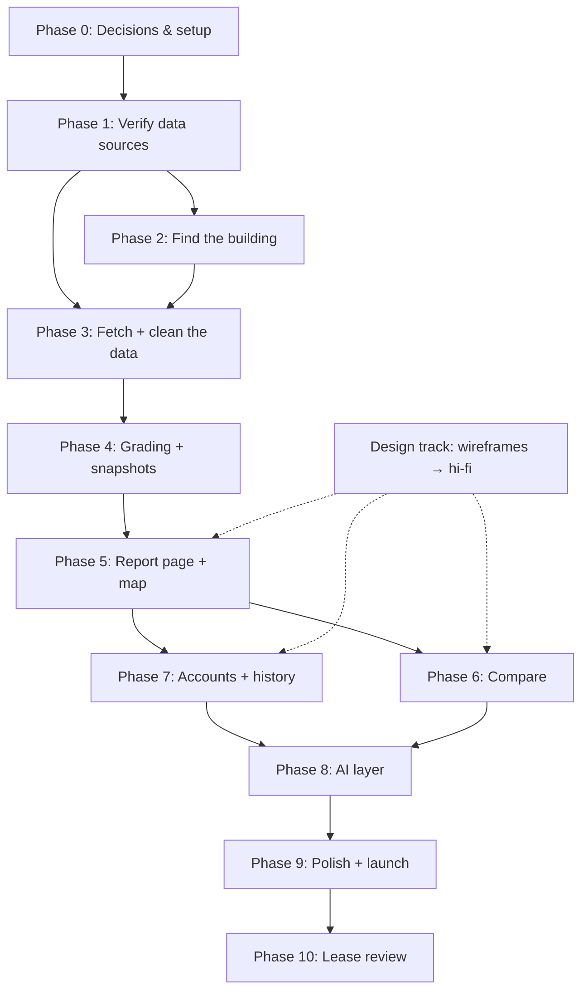

# Hearthstone Hub — Execution Plan

> Companion to `hearthstone-hub-spec.md`. This plan says **what to build, in what order, and why**.

| | |
|---|---|
| **Status** | Draft v1 |
| **Last updated** | October 29, 2026 |
| **Sizing** | S = a day or two · M = a few days · L = a week+ (for one developer; adjust for team size) |

---

## 1. How the order was chosen

1. **Data before screens.** Everything depends on the city data actually being usable. Prove that first, before polishing any UI.
2. **One building end to end, then widen.** Get a single address all the way from search to graded report, then add compare, accounts, history, and AI on top.
3. **Public features before signed-in features.** Search, report, and compare work without login, so they ship first. Accounts add saving, history, and personalization later.
4. **AI last among MVP features.** The AI layer only reasons over report data. It's only as good as the grades underneath it, so it comes after they're solid.
5. **Design runs in parallel.** Wireframes happen while the data pipeline is being built, so they're ready when the first real screens are.

---

## 2. Dependency map

**Critical path:** Setup → Verify data → Fetch + clean → Grading → Report page. Delays here delay everything. Compare, accounts, and AI can overlap once the report page exists.

---

## 3. Phases

### Phase 0 — Decisions & setup *(S–M)*

**Why first:** a few open questions from the spec change how later code is written. Settling them now avoids rework.

**Decide (from spec §16):**
- [ ] Noise radius (default: 150 m)
- [ ] Map tile provider (check free-tier terms)
- [ ] Whether the baseline job runs on Vercel Cron or Supabase/GitHub Actions from the start
- [ ] Who owns Figma wireframes

**Set up:**
- [ ] GitHub repo, branch protection, PR template
- [ ] Next.js (App Router) + TypeScript + Tailwind
- [ ] Design tokens from the spec added to Tailwind config / `globals.css`
- [ ] shadcn/ui installed with base components (Button, Input, Card, Badge, Dialog)
- [ ] Supabase project created, PostGIS enabled
- [ ] Vercel project linked with preview deployments
- [ ] Env vars set (Supabase, Socrata token, Gemini key, `CRON_SECRET`, Sentry DSN)
- [ ] Sentry connected
- [ ] Vitest running in CI on every PR

**Done when:** a "hello world" page deploys to a Vercel preview with the brand colors applied, and CI runs tests.

---

### Phase 1 — Verify data sources *(M)* — **highest risk**

**Why now:** if a dataset is missing fields, has a different join key, or is too slow to query, the grading design changes. Find out before building on it.

- [ ] Get a free Socrata app token
- [ ] For each source (GeoSearch, HPD violations, HPD complaints, rodent inspections, bedbug filings, 311, PLUTO):
  - [ ] Confirm the dataset ID and endpoint
  - [ ] Confirm the join key (BBL, BIN, or lat/lon) and field names
  - [ ] Run a real query for 3–5 test addresses across different boroughs
  - [ ] Save the responses as test fixtures (`/tests/fixtures/`)
- [ ] Pin all endpoints in `lib/sources.ts`
- [ ] Write Zod schemas for each response
- [ ] Test a 311 radius query and a citywide `group by bbl` count to check speed

**Pick test addresses deliberately:** one with lots of violations, one clean, one large building (100+ units), one small (1–5 units), one near a nightlife strip.

**Done when:** every source returns data for all test addresses, schemas pass against fixtures, and any surprises are written back into the spec.

---

### Phase 2 — Find the building *(S–M)*

**Depends on:** Phase 1 (GeoSearch and PLUTO confirmed)

- [ ] `buildings` table migration (BBL PK, BIN, address, borough, `geom`, units, year built)
- [ ] `/api/geocode?q=` route calling GeoSearch, returning top 5 matches
- [ ] PLUTO lookup to fill units and year built on first sight of a building
- [ ] Basic search bar with debounced autocomplete (unstyled is fine)
- [ ] Selecting a result routes to `/building/[bbl]` (placeholder page for now)

**Done when:** typing a real NYC address resolves to the right BBL and saves the building.

---

### Phase 3 — Fetch + clean the data *(L)*

**Depends on:** Phases 1 and 2

- [ ] `issues` table migration with unique `(source, source_id)` and GIST index on `geom`
- [ ] One fetcher per source, each returning the shared `Issue` shape
- [ ] Severity mapping (HPD class A/B/C → 1/2/3; open vs. closed; complaint vs. violation)
- [ ] Cleaning rules in `lib/cleaning-rules.ts`:
  - [ ] Drop excluded 311 types (helicopter, aircraft, etc.)
  - [ ] Drop duplicates / out-of-jurisdiction 311 closures
  - [ ] Drop records with no date and no location
- [ ] De-duplication:
  - [ ] Same type + same location + same night (6 pm–6 am) → 1
  - [ ] Same type + same building + same day → 1
- [ ] Unit tests for every cleaning and dedupe rule (using Phase 1 fixtures)
- [ ] Graceful handling when one source fails (report still builds, notes what's missing)

**Done when:** for each test address, a single function returns a clean, de-duplicated, categorized issue list, and tests cover the rules.

---

### Phase 4 — Grading + snapshots *(L)*

**Depends on:** Phase 3

- [ ] Per-category scoring (weighted issues per unit; noise per 12 months in radius)
- [ ] Size buckets (1–5, 6–20, 21–100, 100+ units)
- [ ] Baseline script that computes citywide percentile cutoffs per category and bucket
  - Run it **locally first** to see the real distribution, then tune the cutoffs
- [ ] `grade_baselines` table + scheduled job to recompute weekly
- [ ] Grade function (score + baseline → A–F)
- [ ] `report_snapshots` table (metrics, grades, issue IDs)
- [ ] `/api/buildings/[bbl]/report`: return fresh snapshot or build one if older than 24 h
- [ ] Unit tests: cutoffs, zero-unit buildings, missing PLUTO data, all-clean building

**Sanity check:** the "lots of violations" test address should grade poorly, and the clean one should grade well. If not, fix the scoring before moving on.

**Done when:** the report API returns sensible grades for all test addresses in a reasonable response time.

---

### Phase 5 — Report page + map *(L)* — **first usable product**

**Depends on:** Phase 4 · hi-fi report design from the design track

- [ ] Address header (units, year built, last updated)
- [ ] Grade cards — letter + color + one-line explanation per category
- [ ] MapLibre block map: building marker, radius circle, complaint markers, category filters, marker popups
- [ ] Recent issue timeline
- [ ] **Static** landlord question list based on which categories scored poorly (AI version comes in Phase 8)
- [ ] Loading, empty, and partial-data states
- [ ] Mobile layout (stacked)
- [ ] Data disclaimer

**Done when:** anyone can search an address and get a complete, readable report on a phone or laptop. **Demo this to real renters and collect feedback.**

---

### Phase 6 — Compare *(M)*

**Depends on:** Phase 5 · can run in parallel with Phase 7

- [ ] "Add to compare" on the report page (stored in URL + local storage, max 3, no login needed)
- [ ] `/api/compare?bbls=` route
- [ ] Compare page: one column per building, one row per category, best per row highlighted
- [ ] Mobile layout (swipe or stacked cards)

**Done when:** a user can compare 2–3 buildings without an account.

---

### Phase 7 — Accounts + history *(L)*

**Depends on:** Phase 5 · can run in parallel with Phase 6

- [ ] Supabase Auth (magic link + Google), `/login` page
- [ ] Middleware: session refresh, protected routes
- [ ] Tables: `profiles`, `saved_buildings`, `comparisons` — **with RLS policies and tests for them**
- [ ] Save / unsave buildings; save comparisons
- [ ] Profile page: "My situation" form, saved buildings, saved comparisons
- [ ] Snapshot diffing ("2 new problems, 1 resolved since last month")
- [ ] `/api/buildings/[bbl]/history` + "What changed" section on the report page
- [ ] Daily cron: refresh snapshots for every saved building
- [ ] "New" badges on saved buildings in the profile

**Tip:** start the daily cron as early as possible in this phase. The "what changed" feature only becomes visible after a few weeks of snapshots exist.

**Done when:** a signed-in user can save buildings, fill in their situation, and see changes over time.

---

### Phase 8 — AI layer *(M–L)*

**Depends on:** Phases 6 and 7 (needs compare data and the "My situation" profile)

- [ ] Gemini client (server-only) with Zod-validated JSON output and one retry
- [ ] **Landlord questions** prompt — replaces the static list, falls back to it on failure
- [ ] **Personalized advice** prompt — single report or comparison + situation
- [ ] Guardrails in every prompt: data-only, no protected characteristics, state data gaps
- [ ] `ai_analyses` cache keyed on input hash
- [ ] Rate limiting on AI routes
- [ ] "Ask Hearthstone" button + results panel on report and compare pages
- [ ] Prompt test set: run each prompt against the fixture addresses and review outputs by hand

**Done when:** advice is specific, cites the grades it's based on, never invents records, and the site still works if Gemini is down.

---

### Phase 9 — Polish + launch *(M)*

**Depends on:** all MVP phases

- [ ] Final home page (hero search, how-it-works cards, sample report teaser)
- [ ] Motion animations, used sparingly
- [ ] Accessibility pass: keyboard navigation, focus states, contrast on grade colors, letters shown with colors
- [ ] Playwright E2E: search → report; compare two buildings; sign in → save → profile
- [ ] Performance check on report page (map and data loading)
- [ ] Rate limits on report building
- [ ] SEO basics: page titles, meta descriptions, Open Graph image
- [ ] Sentry alerts configured
- [ ] Production deploy

**Done when:** all E2E tests pass, no open critical bugs, and the site is live.

---

### Phase 10 — Lease review *(L, post-launch)*

**Depends on:** launch

- [ ] Private Supabase Storage bucket + `leases` table with RLS
- [ ] Upload page; PDF.js text extraction (digital PDFs only)
- [ ] Gemini lease prompt with clause flags and "ask about this" notes
- [ ] Delete lease (file + extracted text)
- [ ] "Not legal advice" notice

---

## 4. Design track (parallel)

| When | Deliverable | Needed by |
|---|---|---|
| During Phases 1–2 | Low-fi wireframes: Home, Report, Compare, Profile (desktop + mobile) | — |
| During Phases 3–4 | Hi-fi Report page using the spec's palette | Phase 5 |
| During Phase 5 | Hi-fi Compare + Profile | Phases 6–7 |
| During Phase 7 | AI panel + final Home page | Phases 8–9 |

---

## 5. Splitting work across a team

If there are 2–4 people, a natural split:

| Track | Phases | Owner |
|---|---|---|
| **Data & backend** | 1 → 3 → 4, then cron/history in 7 | Backend lead |
| **Frontend** | 0 setup, 2 search UI, 5 → 6, then 9 | Frontend lead |
| **Design** | Design track above | Designer |
| **Accounts & AI** | 7 (auth, RLS, profile), then 8 | Full-stack |

Agree on the `Issue` type and the report API response shape **in Phase 1**, so frontend can build against mock data while the pipeline is still in progress.

---

## 6. Milestone mapping

How these phases line up with the milestones in the spec:

| Spec milestone | Phases |
|---|---|
| M1 Foundation | 0 |
| M2 Find + fetch | 1, 2, 3 |
| M3 Grades + report page | 4, 5 |
| M4 History + accounts | 7 |
| M5 Compare + AI | 6, 8 |
| M6 Polish + launch | 9 |
| P2 Lease review | 10 |

---

## 7. Risks to watch

| Risk | Phase | Mitigation |
|---|---|---|
| A dataset is missing fields or uses a different key | 1 | Verify every source first; adjust spec before building |
| 311 queries are slow or rate-limited | 1, 3 | Always filter by radius + date; use app token; cache in `issues` |
| Grades feel wrong to real renters | 4, 5 | Tune cutoffs on real distribution; test with known good/bad buildings; get user feedback in Phase 5 |
| Baseline job exceeds Vercel time limits | 4 | Run locally first; move to Supabase/GitHub Actions if needed |
| "What changed" has nothing to show at launch | 7 | Start the daily cron early |
| AI invents facts or gives unfair advice | 8 | Data-only prompts, structured output, guardrails, hand-reviewed test set |
| Gemini outage or cost spike | 8 | Static fallbacks, caching, rate limits |
